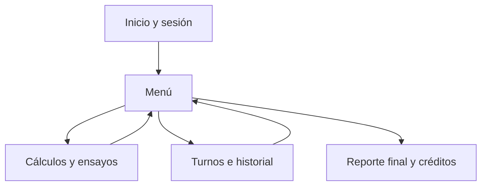

# Artemis LEO — Simulador de órbita terrestre baja

Trabajo Final Integrador de Laboratorio de C — Algoritmos y Estructuras de Datos.
Universidad Tecnológica Nacional, Facultad Regional Resistencia.

## Equipo
- Grupo 1 **struct_J2A**
- Comision: k1.4 (D)

## Miembros del equipo
- Guido Burgos.
- José Marín.
- José Pastori.

## Video de presentación

**[Enlace del video.](https://youtu.be/E7iikF7RLBA?si=sipnI5iTRfSk5HuX)**

## Escenario asignado: **2**
Orion se encuentra en una órbita circular de estacionamiento a 192 km sobre la Tierra,
con una masa de 33.000 kg. El simulador calcula velocidad orbital, período y aceleración
centrípeta; permite ensayar otras altitudes y un pulso de propulsor lateral.
Además, permite avanzar el tiempo de la órbita nominal por turnos, consultar su historial
y obtener un reporte final de la sesión.

Es un modelo educativo de MCU y gravitación: Tierra esférica, masa terrestre constante,
sin arrastre atmosférico, sin otras perturbaciones y sin consumo de combustible.
Las altitudes personalizadas representan órbitas circulares ideales independientes;
no prueban estabilidad real a largo plazo. La opción lateral es una aproximación local,
no un integrador de trayectorias orbitales posteriores al impulso.

## Reglas y funcionamiento

Al iniciar, presionar ENTER en la terminal. La sesión comienza a tiempo cero en la
órbita nominal de 192 km. El objetivo de seguimiento es completar al menos una vuelta
mediante avances de tiempo; no se asignan puntos ni se simulan fallas aleatorias.

| Opción | Acción |
| --- | --- |
| 1 | Mostrar telemetría nominal y contar una consulta. |
| 2 | Ensayar una altitud de 100 a 2000 km; masa fija de 33.000 kg. |
| 3 | Ensayar un pulso lateral: aceleración de 0,01 a 10 m/s² y duración de 0,1 a 120 s. |
| 4 | Ver reporte final, despedida y postcréditos; finalizar. |
| 5 | Avanzar entre 0,1 y 86.400 segundos de la órbita nominal. |
| 6 | Ver historial de turnos sin modificar el estado. |

Los ensayos de las opciones 2 y 3 no cambian la órbita nominal seguida en la opción 5.
Cada turno registra tiempo acumulado y ángulo orbital. Hay capacidad para 100 turnos;
al llegar al límite se conservan los registros y se impiden nuevas escrituras.
Las consultas y ensayos siguen disponibles. Una nueva ejecución inicia una sesión vacía.
El reporte muestra consultas, ensayos, turnos, tiempo, vueltas y cumplimiento del objetivo.
Los datos permanecen en memoria; no se guardan al cerrar.

Usar **punto decimal** (`192.5`). Las entradas vacías, fuera de rango, con letras sobrantes,
excesivamente largas, `nan`, `inf` y desbordamientos numéricos son rechazadas.
Al terminar la entrada (EOF), se cierra el programa sin un bucle infinito; el reporte final
se obtiene mediante la opción 4. Los postcréditos son ficticios y no alteran los resultados.

## Modelo físico

Constantes: G = 6,674 × 10⁻¹¹ N·m²/kg²; M = 5,972 × 10²⁴ kg;
R = 6.371.000 m; g de referencia = 9,80 m/s².

La gravedad proporciona la fuerza centrípeta:

`Fg = G*M*m/r² = m*v²/r = Fc`

Al cancelar la masa de Orion: `v = sqrt(G*M/r)`. Por eso la velocidad de una órbita
circular ideal no depende de la masa de la nave; su fuerza gravitatoria sí depende de ella.

| Magnitud | Fórmula | Resultado nominal aproximado |
| --- | --- | --- |
| Radio orbital | r = R + h | 6.563.000 m |
| Velocidad | v = sqrt(G*M/r) | 7.792,95 m/s |
| Período | T = 2*pi*r/v | 5.291,52 s = 88,19 min |
| Aceleración centrípeta | ac = v²/r | 9,2534 m/s² |
| Posición angular | theta = (360*t/T) módulo 360 | Depende del tiempo acumulado |
| Desviación local | dy = a*dt²/2 | 25 m para a = 0,50 y dt = 10 |
| Cambio de velocidad lateral | dv = a*dt | 5 m/s en el mismo caso |

`ac/g` compara aceleraciones; no representa la carga aparente que sienten los astronautas:
en una órbita ideal la nave y la tripulación están en caída libre.

Para el pulso se supone velocidad lateral inicial nula y aceleración constante en una
dirección transversal local. Durante ese intervalo aparece una desviación parabólica
local respecto de la referencia. La gravedad continúa actuando y la órbita original queda
perturbada; determinar la órbita posterior requiere la dirección tridimensional del pulso
y un modelo adicional. La precisión de esta aproximación disminuye para pulsos grandes.

## Organización y estructuras

| Archivo | Responsabilidad |
| --- | --- |
| `src/main.c` | Inicio, menú y coordinación de llamadas. |
| `src/artemis.c`, `.h` | Constantes, estructura `NaveOrion`, cálculo y reporte físico. |
| `src/sesion.c`, `.h` | Estado de sesión, turnos, historial y reporte final. |
| `src/validaciones.c`, `.h` | Lectura por líneas, conversión y validación de entradas. |
| `src/funcion_global.c`, `.h` | Limpieza de pantalla y configuración de consola. |
| `src/intro_outro.c`, `.h` | Animaciones, detección de ENTER y créditos. |
| `scripts/` | Compilación para Mac/Linux y Windows. |
| `tests/` | Pruebas reproducibles de física, límites y validaciones. |
| `docs/` | Registro de IA, pruebas y guía de defensa. |

`Sesion` contiene una `NaveOrion` y un arreglo `RegistroTurno historial[100]`.
`cantidad` indica cuántas posiciones están ocupadas. Los módulos reciben punteros para
modificar el estado original sin copiar estructuras completas; los reportes reciben
punteros `const` porque solo leen. También existe un arreglo de nombres en los créditos.
No se usa memoria dinámica.



## Compilación y ejecución

Se compila desde la carpeta **Artemis_LEO**, donde están `src` y `bin`.
Se deben ejecutar la compilacion de los siguientes archivos .c:
- main.c
- artemis.c
- funcion_global.c
- intro_outro.c
- validaciones.c

Cada sistema operativo genera su propio archivo binario compilado ejecutable, y se guarda en la carpeta "bin" de correspondiente

### Windows

Requiere GCC para Windows. En CMD o PowerShell, desde la raíz se ejecuta el comando:
```bat
gcc src/main.c src/artemis.c src/funcion_global.c src/intro_outro.c src/validaciones.c -o bin\win\executor.exe -lm
```
Y para ejecutar el programa:
```bat
.\bin\win\executor.exe
```

### Linux

Requiere GCC y las herramientas estándar de consola.
Comando para compilar:
```sh
gcc src/main.c src/artemis.c src/funcion_global.c src/intro_outro.c src/validaciones.c -o bin/lin/executor -lm
```
Comando para ejecutar:
```sh
./bin/lin/executor
```

### macOS

Requiere las herramientas de línea de comandos de Apple, incluido Clang. Si faltan,
instalarlas con `xcode-select --install`.
Compilacion:
```sh
clang src/main.c src/artemis.c src/funcion_global.c src/intro_outro.c src/validaciones.c -o bin/mac/executor -lm
```
Ejecucion:
```sh
clang src/main.c src/artemis.c src/funcion_global.c src/intro_outro.c src/validaciones.c -o bin/mac/executor -lm && ./bin/mac/executor
```

## Uso de inteligencia artificial

Se utilizó ChatGPT/Gemini como apoyo para comprender C, organizar módulos, resolver errores de
compilación y entrada sistemas UNIX, configurar la terminal al momento de ejecutar en windows, proponer animaciones y completar documentación.
En la preparación final, ayudo en el debugueo de errores al compilar y ejecutar.

Cada modulo creado fue analizado y testeado por los miembros del equipo.
